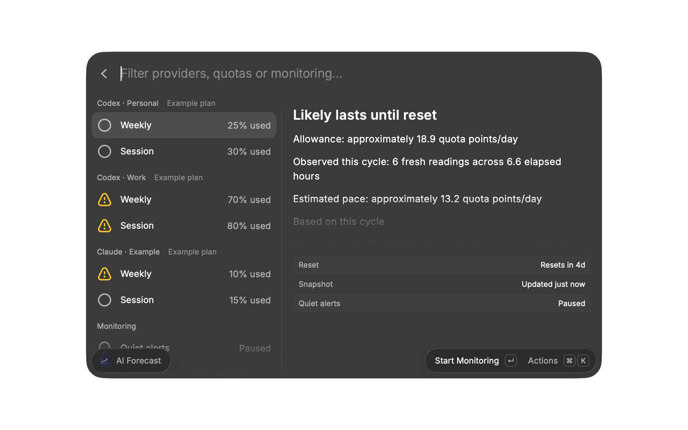
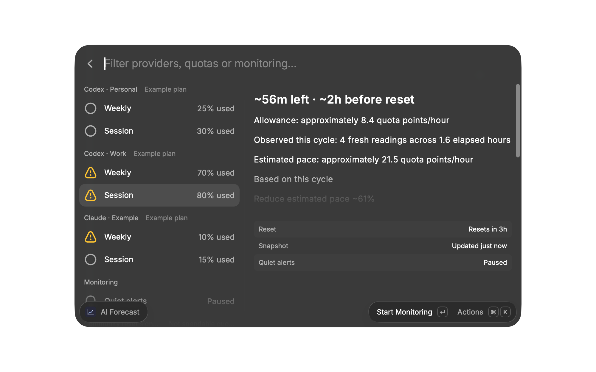
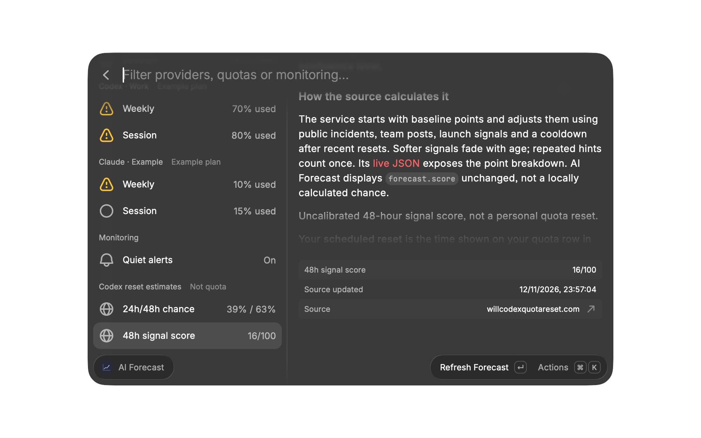

# AI Forecast

A Raycast extension for Claude and Codex quota forecasts and quiet alerts, using usage snapshots collected by OpenUsage. Open **AI Forecast** in Raycast to see the forecast; it does not add a menu bar item.

## Requirements and OpenUsage compatibility

- macOS, [Raycast](https://www.raycast.com/), and [OpenUsage](https://github.com/robinebers/openusage/blob/v0.8.0/README.md#installation) with Claude and/or ChatGPT accounts configured. OpenUsage 0.8.0 requires macOS 15 or newer.
- Python **3.12 or newer**, using only the standard library. Python 3.12 is the supported baseline; older versions may work but are unverified. For source development, Node.js **22.22.2 or newer** and npm are required by the locked Raycast SDK in [package-lock.json](package-lock.json).

### OpenUsage 0.8.0: cached CLI

Install OpenUsage using its [official instructions](https://github.com/robinebers/openusage/blob/v0.8.0/README.md#installation), configure your accounts, and keep the app running so it can fetch usage. In OpenUsage, choose **Settings → Advanced → Command Line → Install…**. This asks for an administrator password and links the helper at `/usr/local/bin/openusage`; app updates update the command as well ([OpenUsage 0.8.0 CLI documentation](https://github.com/robinebers/openusage/blob/v0.8.0/docs/cli.md)).

AI Forecast runs the installed `openusage` CLI without arguments and reads its cached `openusage.limits.v2` JSON. It detects the command in `/usr/local/bin`, `/opt/homebrew/bin`, or absolute directories in `PATH`. If installed elsewhere, set the optional **OpenUsage helper override** in Raycast preferences to its trusted full path. Only select a program you trust: AI Forecast executes it.

The CLI does not refresh usage, sign in, read credentials, or launch OpenUsage. Exit code 4 with a valid empty envelope means nothing has been fetched yet: open OpenUsage and add or refresh an account. Each account has a separate ID and display name; AI Forecast uses only Claude and Codex weekly and session windows.

### Older OpenUsage: HTTP fallback

If no CLI is installed, AI Forecast falls back to `GET http://127.0.0.1:6736/v1/limits`, accepting the `openusage.limits.v1` schema documented for [OpenUsage 0.7.16](https://github.com/robinebers/openusage/blob/v0.7.16/docs/local-http-api.md). Its local server starts with the app but is disabled for that session if port 6736 is occupied. The API also serves cached snapshots. A CLI that is present but fails does **not** trigger HTTP fallback. Do not downgrade OpenUsage solely for this extension without considering the security and maintenance trade-offs.

The extension searches for executable `python3` in `/opt/homebrew/bin`, `/usr/local/bin`, the Command Line Tools directory, then absolute directories in its `PATH`. It deliberately skips the `/usr/bin/python3` system installer stub during detection. It selects the first executable found, without checking its version; Command Line Tools may provide an older Python. If the selected interpreter is too old or your installation is elsewhere, set **Python executable override** in extension preferences to the full path of a suitable interpreter. We recommend a current Python installed with `brew install python` using [Homebrew](https://docs.brew.sh/Homebrew-and-Python).

The tested forecast engine remains in Python for continuity and its `flock`-based state coordination. A TypeScript rewrite could remove the separate Python runtime, but is not required by the Raycast Store and would not by itself change the Script Editor attribution of AppleScript notifications.

## Install from source

```sh
git clone https://github.com/Thomasevano/raycast-ai-forecast.git
cd raycast-ai-forecast
npm ci --ignore-scripts
npm run dev
```

The [Raycast development command](https://developers.raycast.com/information/developer-tools/cli#development) imports the extension into Raycast and reloads changes while it runs. `npm run bundle` creates a `.rayext` archive using the [Raycast CLI](https://developers.raycast.com/information/developer-tools/cli#bundle).

1. Open **AI Forecast** in Raycast. Connected consumption windows appear; unavailable Claude or Codex windows are hidden.
2. Select **Weekly** for a daily allowance, or **Session** for an hourly allowance and short-term forecast.
3. Use **Refresh Forecast** to reread the OpenUsage snapshot; this does not force an upstream refresh.
4. Choose **Start Monitoring** in the action menu, or select **Quiet alerts** and press Enter. Monitoring starts paused on a new installation.
5. In Raycast extension preferences, enable **Background Refresh** for **Monitor AI Quotas**. Reopen the forecast later and check that **Last successful check** advances without opening the view.

**Pause Monitoring** preserves history; an already-running check may finish. **Send Test Notification** submits one macOS notification without changing quota alert deduplication.

Raycast schedules the monitor approximately once a minute, not on an exact timer. Sleep, energy management, quitting Raycast, disabled background refresh, or unavailable OpenUsage can prevent checks. The view reports the last successful monitor check and its last error; an overdue check is not presented as healthy. See [Raycast background refresh](https://developers.raycast.com/information/lifecycle/background-refresh).

## Forecast and alerts

- **Allowance** spreads your remaining quota evenly until its scheduled reset: weekly quota points per day, or Session quota points per hour. **1 point is 1% of the full corresponding quota**, not 1% of what remains. A day means 24 elapsed hours, not a working day. With less than one day/hour left, the view shows the remaining points instead of an inflated normalized allowance. Values are approximate, not guaranteed spending ceilings.
- **Estimated pace** is a model of how quickly you consume that quota. Monitoring—not opening the view—builds its history from distinct fresh OpenUsage readings. It measures elapsed calendar time, including idle time; it does not count messages, conversations, or working sessions.
- A new weekly model needs **three readings spanning six hours**. A Session model needs **three readings spanning one hour**, or a quarter of its quota window if shorter. A Session is a provider's short-term quota window, not a conversation.
- Once ready, the current-cycle pace is half the cycle-average rate and half the observed change over up to the last 24 hours. Up to **four eligible previous cycles** are retained for the same account, quota type, plan and window length. Their observed rates provide a **provisional** estimate during learning; afterwards the estimate is 75% current-cycle pace and 25% historical mean. No unobserved cycle-end totals are invented.
- A forecast alert requires a ready **weekly** model, a projected overshoot of at least five quota points and exhaustion at least six hours early, sustained for 30 minutes across three distinct fresh readings. A historical-only estimate cannot trigger it; Session projections do not add a new risk-alert category.
- Risk warnings repeat only after at least 24 hours and material worsening. Recovery uses lower thresholds to avoid chatter.
- Fresh reported consumption at or above 100% has its own once-per-quota-window exhaustion notification, for either quota type. Missing, expired, stale, future, and out-of-order readings cannot produce a fresh warning.
- Real reset boundaries can archive sufficiently observed rates. Counter drops recalibrate the current curve; changed or missing plan/window metadata prevents incompatible history from being mixed. Failed notification dispatch does not consume the alert.

There is no notification merely because the forecast was opened, or for every percentage change.

## macOS notifications

Quota alerts and the test action use `/usr/bin/osascript` to submit AppleScript notifications, attributed to **Script Editor** (`com.apple.ScriptEditor2`). In **System Settings → Notifications → Script Editor**, allow notifications and choose an alert style. Focus, display sleep and other notification settings can affect presentation; see [Apple's notification settings guide](https://support.apple.com/guide/mac-help/change-notifications-settings-mh40583/mac). A successful script dispatch does **not** prove a banner was displayed. Raycast toasts are feedback for explicit actions, not the background quota alert mechanism.

## Optional community reset signals

**Community reset signals** is enabled by default and can be disabled in extension preferences. With a Codex account present, opening or refreshing the view may request these public HTTPS endpoints independently, with bounded timeouts. Normalized public readings are cached in Raycast for at least one minute per source, including across view reopenings; HTTP 429 `Retry-After` delays are honored.

- [`codex-reset.com/api/forecast`](https://codex-reset.com/api/forecast): experimental **global-reset display estimates** for 24 and 48 hours, both visible directly in the list. AI Forecast passes through the [documented](https://codex-reset.com/developers) `probabilities.rounded_24h` and `rounded_48h` fields. The source uses historical reset frequency and can apply caps or floors for public hints and commitments; these display values are not calibrated probabilities. Its [method page](https://codex-reset.com/forecast-method) now mainly describes the homepage's separate combined global-reset-or-new-banked-grant outlook, not an exact formula for these global-only API fields. A banked grant does not refill personal quota until redeemed.
- [`www.willcodexquotareset.com/api/forecast`](https://www.willcodexquotareset.com/api/forecast): an **uncalibrated signal score out of 100**, for 48 hours only—not a probability, a statistical confidence level, or a 24-hour forecast. Its [published explanation](https://www.willcodexquotareset.com/) describes baseline points adjusted for incidents, team posts, launch signals and a recent-reset cooldown, with softer evidence fading and repeated hints counted once. AI Forecast displays `forecast.score` unchanged as `/100`, not `%`; the public JSON provides the source's point breakdown.

These sites watch for exceptional public Codex reset events. Your **scheduled account reset** comes from OpenUsage and remains the only reset used in the allowance calculation. The sites share signals and are **not independent evidence**: their numbers are shown separately, never averaged, and never enter the allowance, pace model or alerts. Malformed, future-dated or over-one-hour-old data is unavailable; one failed source does not hide the other or your local forecast. The background monitor never contacts either site.

Each detail view links its data source and explains the calculation and its limits. In accordance with [Codex Reset's public API terms](https://codex-reset.com/developers), requests identify **AI Forecast** and this public repository in their User-Agent. They do not include quota or account data, but the services and network intermediaries can observe normal connection metadata such as your IP address. Following a source or method link explicitly also connects to that website.

The [public source assessment](docs/reset-sources.md) covers Claude, DeepSeek, OpenCode Go, Gemini and Grok. Those research links are not additional integrations: this release does not treat incident status, personal reset schedules or insufficient historical data as exceptional-reset predictions.

## Local data and privacy

AI Forecast reads OpenUsage's local snapshot; it does not sign in to providers, read their tokens, scrape account websites, or request a provider sync. OpenUsage has its own data practices; consult the privacy documentation for your version ([0.8.0](https://github.com/robinebers/openusage/blob/v0.8.0/docs/privacy.md), [0.7.16](https://github.com/robinebers/openusage/blob/v0.7.16/docs/privacy.md)). The 0.7.x API listens only on loopback, but its permissive CORS policy means **web pages in your browser can read usage snapshots while it is running**. It does not serve credentials ([upstream API privacy note](https://github.com/robinebers/openusage/blob/v0.7.16/docs/local-http-api.md#cors-and-privacy)).

AI Forecast stores account IDs, bounded usage samples, window metadata, plan fingerprints, bounded prior-cycle rates and alert metadata in `~/Library/Application Support/AI Forecast/state.json`, not provider tokens, account display names, or raw API errors. It uses a `0700` directory and `0600` state and lock files. Opening the view runs the forecast engine in an in-memory preview: it does not create history files or write samples or notification flags. Corrupt history fails closed rather than being silently discarded. Raycast LocalStorage holds the monitoring toggle, last successful check time, and a sanitized diagnostic. A separate Raycast Cache stores normalized public reset readings and retry deadlines, not account usage.

### Migrating version 1 history

Version 1 numeric samples and notification deduplication state are adopted for a unique account of the same provider kind. When multiple accounts of that kind exist, migration fails closed rather than guessing. The current state records an explicit account binding, which persists when accounts disappear; later v1 input reuses that binding.

State version 3 preserves earlier account bindings and exhaustion/risk flags. Older numeric samples lack trustworthy plan/window provenance: they are retained separately, not used as input to the new pace profile, which must learn once from fresh readings. The earlier numeric history is retained; no historical weeks are invented.

To resolve an **Ambiguous legacy history** error, use the exact account ID from your trusted local OpenUsage CLI output and bind the old history explicitly. Stop monitoring first and use your actual absolute paths and account ID in this example:

```sh
openusage | python3 /absolute/path/to/raycast-ai-forecast/assets/openusage-model.py \
  --state-dir "$HOME/Library/Application Support/AI Forecast" \
  --assign-legacy 'claude=claude@ACCOUNT_ID'
```

For Codex, use `--assign-legacy 'codex=codex@ACCOUNT_ID'`; repeat the option to bind both kinds. The v2 snapshot must contain each exact target account. Already bound providers cannot be reassigned, so verify each account ID carefully. All choices and collisions are validated before an atomic state write; this operation does not add samples or send notifications. Do not share the raw OpenUsage output. Resume monitoring after a successful assignment.

## Screenshots

Native Raycast captures from an isolated, read-only preview with synthetic accounts and quotas.







## Checks

```sh
npm test
npm run build
npm run typecheck
npm run lint
npm run bundle
```

The Python suite covers forecast math, freshness, resets, out-of-order data, notification deduplication and failures, permissions, corrupt state, and preview isolation. A build or test suite alone does not verify Raycast's native window, background scheduler, or Notification Center presentation.
